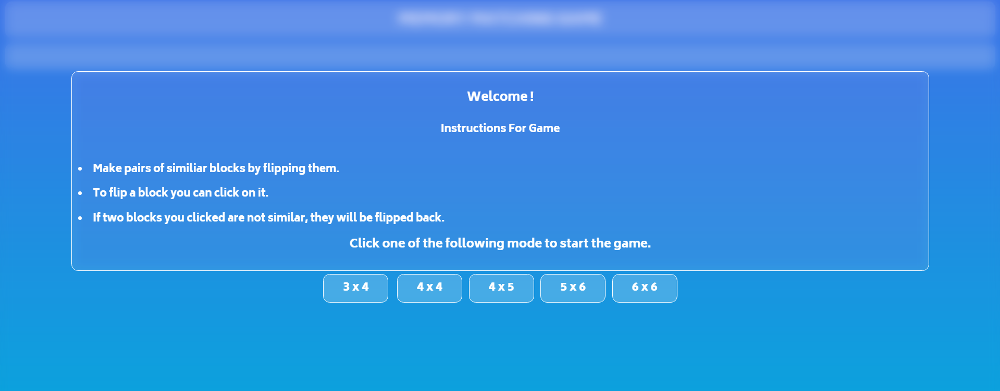
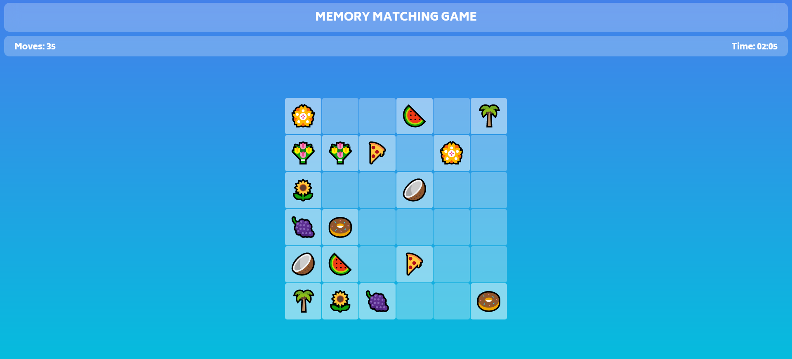
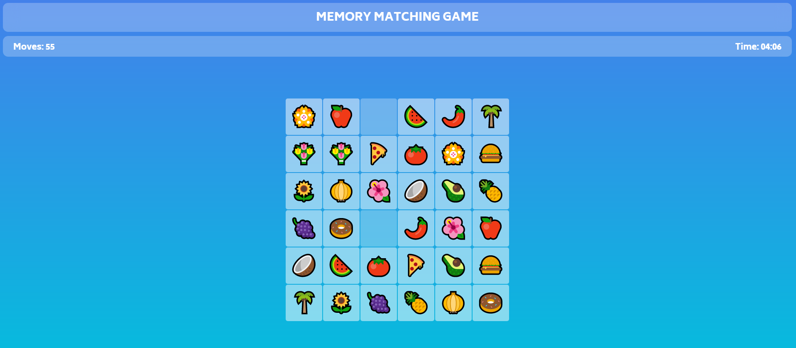
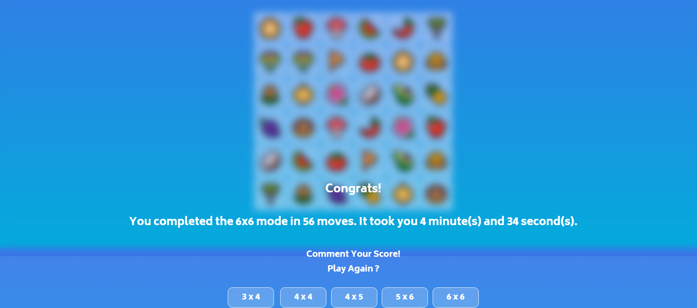

# Brain Flip

Brain Flip is a colorful memory matching game built with HTML, CSS, and JavaScript. Flip cards to find pairs, beat the clock, and test your memory across five difficulty levels.

## Features

- Five board sizes: 3 × 4, 4 × 4, 4 × 5, 5 × 6, and 6 × 6
- Smooth card-flip animations
- Move counter and game timer
- Randomized card positions
- Responsive layout for desktop and mobile
- Completion screen with score details

## Play Locally

1. Clone the repository:
   ```bash
   git clone https://github.com/Amur-Tigro-cell/Brain_Flip.git
   cd Brain_Flip
   ```

2. Start a local server:
   ```bash
   python3 -m http.server 4173
   ```

3. Open [http://127.0.0.1:4173](http://127.0.0.1:4173) in your browser.

## Screenshots

<div>
  
  
</div>

<div>
  
  
</div>

## Technology

- HTML5
- CSS3
- Vanilla JavaScript
